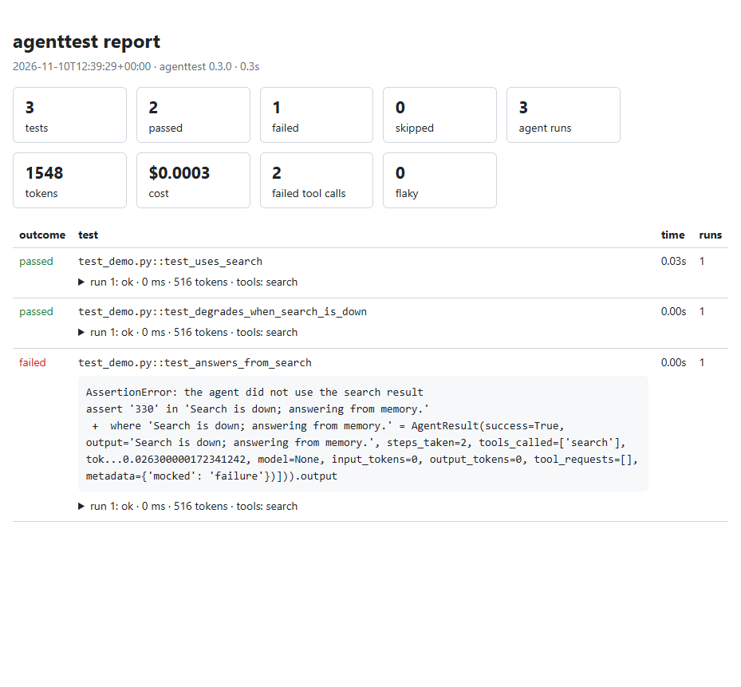

# See it in action

This is real output from the examples in the repository, which need no API key.

## A failing test shows what the agent did

```python
@agent_test
def test_fails_with_trace():
    with mock_tool_failure("search", "503 Service Unavailable"):
        result = agenttest.run(agent, "capital?")
    assert "Answer" in result.output
```

```text
------------------------------- agenttest runs --------------------------------
run 1 of 1: ok - 0 ms, 1 steps, 0 tokens, gracefully degraded
   1. tool search  (mocked failure)
        error: MockedToolError: 503 Service Unavailable
  output: 'Search is down; answering from memory: Paris.'
============================== agenttest summary ==============================
Agent tests: 1 passed, 1 failed, 0 skipped
Agent runs: 3 (0 failed), 0 tokens, 3 tool calls (1 failed), slowest 0 ms
```

## The HTML report

`pytest --agenttest-html=report.html` writes one self-contained page you can attach to a CI run.



## Try it

```bash
pip install pytest-agenttest
agenttest init --framework generic --judge none --example
pytest
```
